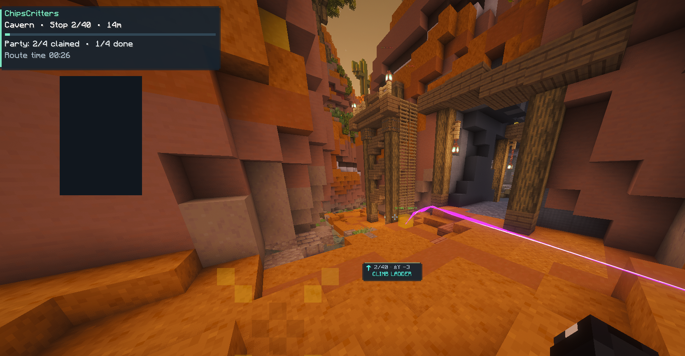
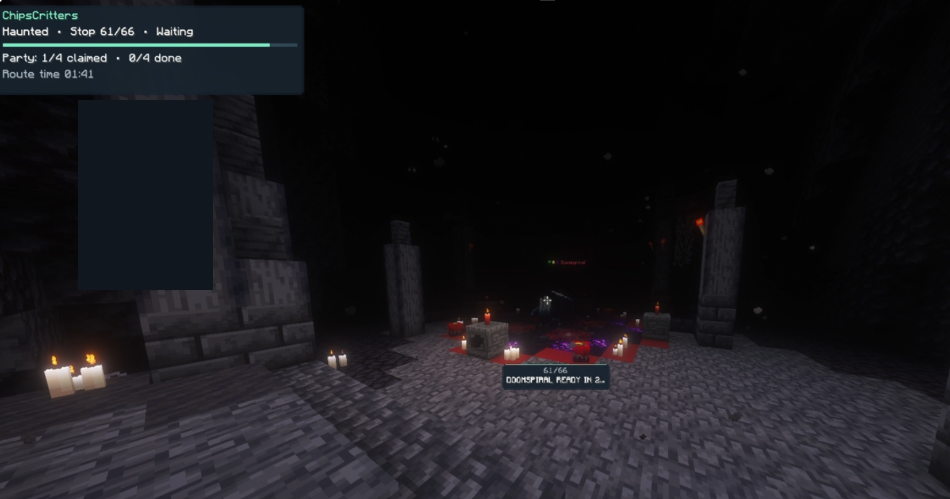
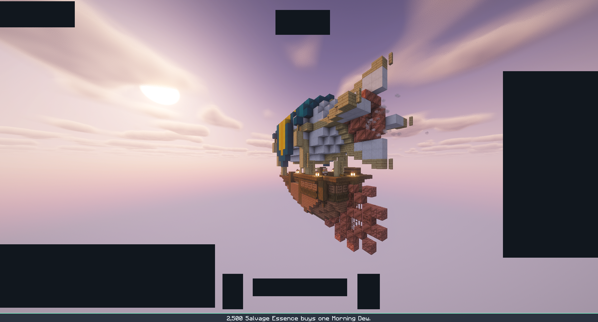

# ChipsCritters

**AI-generated, open source (MIT)** client-side Fabric helpers for Hypixel SkyBlock Critter Safari. Release candidate **0.1.65**, Minecraft **26.2**, Java **25**. The code is MIT; third-party data retains the licenses documented in [THIRD_PARTY_NOTICES.md](THIRD_PARTY_NOTICES.md).

**Hypixel has not confirmed that ChipsCritters is allowed. Players use it at their own risk.** No approval or account-safety guarantee is claimed.

## Official project and downloads

- [Source repository](https://github.com/chipsxo/ChipsCritters)
- [GitHub Releases](https://github.com/chipsxo/ChipsCritters/releases) — PUBLIC downloads will appear here only after Chris approves publication.
- [Bug reports / Issues](https://github.com/chipsxo/ChipsCritters/issues)
- Modrinth: listing text is prepared, but a project/download URL has not yet been published or verified. Follow only a Modrinth project linked here by Chris.

Install only one PUBLIC JAR for normal use. DEV is Chris's local recording/editing build and is not a public release asset. PUBLIC and Modrinth must use the exact same PUBLIC JAR and SHA-256 checksum.

## Features

Fixed-coordinate routes for Cavern, Forest, Haunted and Icy; Money, Unique and Full Clear modes; waypoint cubes and route ribbons; a directional waypoint panel; active mode names on the main route panel; route clocks, personal bests and history; movable HUD elements and airship tip banner; manual fixed-spot Hideyho search; and a six-second Doomspiral ready countdown with a double ding. A personal throw can show readiness sooner; only the own capture message marks Doomspiral caught.

Unique with a verified Shining Coin compares estimated added routed travel time for the existing Gimmiegold stop. It preserves the other remaining stops' order and finishes after Doomspiral once Gimmiegold is done. Without a coin, Gimmiegold stays after Doomspiral. Full Clear is a solo sweep.

Fresh stop counts, before run-specific catch/claim filtering or custom learned stops:

| Biome | Money | Unique | Full Clear |
|---|---:|---:|---:|
| Cavern | 40 | 40 | 40 |
| Forest | 45 | 45 | 45 |
| Haunted | 58 | 66 | 73 |
| Icy | 27 | 27 | 27 |

Unique Haunted with Hideonwall disabled is 58. All players initially use the same bundled waypoint data. Signed route updates can replace route data at a new-run boundary; they do not overwrite personal settings, bindings, HUD positions, learned stops, PBs or history.

## PUBLIC commands

`/sr` opens settings and is a shortcut for `/chipscritters`. Both names register the same PUBLIC command tree. The list below is checked against the built PUBLIC JAR; these are registration/parser checks, not claims of live in-game testing.

| Command | Purpose |
|---|---|
| `/sr help` | Command help |
| `/sr controls` | Keybind controls |
| `/sr pause`, `/sr resume` | Pause/resume route guidance |
| `/sr skip [number]` | Skip one stop or select a later waypoint number; skips are not catches/claims |
| `/sr back`, `/sr undo` | Review a preceding stop / undo the supported last route action |
| `/sr refresh` | Refresh visible guidance |
| `/sr refresh claims` | Open confirmation before restoring the current biome's reached/claimed stops |
| `/sr rejoin` | Rejoin the route from the current position |
| `/sr newrun` | Manual run-state reset; personal bests/history remain |
| `/sr find hideyho`, `/sr find stop` | Start/end a temporary search through the 20 fixed Hideyho locations |
| `/sr status` | Current route/update status |
| `/sr stop`, `/sr restart` | Stop/restart the route |
| `/sr report` | Local diagnostic summary and Issues link |
| `/sr history`, `/sr stats` | Saved route history/statistics |
| `/sr waypoints` | Waypoint information/tools |
| `/sr locraw` | Explicitly request one visible lobby-information reply |

PUBLIC has no recording commands or RouteRecorder classes. Other mods' /locraw replies and ordinary /locraw are hidden because the shared SEND_COMMAND event cannot reliably prove a command was typed by a human. Use `/sr locraw` for a visible debug reply. A late Fabric event phase suppresses display after normal listeners receive the original JSON.

## Network access and local data

Runtime network access is limited to:

1. `https://api.hypixel.net/v2/skyblock/bazaar` for Bazaar prices.
2. `https://raw.githubusercontent.com/chipsxo/ChipsCritters/main/routes-signed.json` for optional signed route data.
3. A user-configured optional relay endpoint. **Relay is OFF by default and the endpoint is blank.**

There is no telemetry or remote code execution. The mod never downloads/runs scripts, commands or JARs from route updates. It does not read or send session tokens, Microsoft login data, launcher/account files, Discord data or passwords. Player preferences, history, PBs and route cache live in the mod's own config files/folder. It reads fixed game chat signals, the player's own inventory, position and loaded terrain for navigation/UI; it does not scan critter entities or nametags.

The optional relay scopes fixed-coordinate claims to the current Safari lobby using a hashed lobby identity and a random ephemeral relay origin identifier; that identifier is not a Minecraft account/session credential. No endpoint or write credential is bundled. The client sends no chat, inventory, raw account/session credentials or raw lobby ID through the relay.

A route-data check happens in the background with timeouts and a cooldown. Missing, invalid or offline responses retain the last verified data or bundled data. A valid signature, schema, data version, minimum mod version and coordinate/safety validation are required. Updates are staged until a new run; they never replace an active run. The first-use notice discloses the download and the setting can disable it.

## Build from public source

Requirements: **Java 25 JDK**, Git, and Internet access for the Gradle/Minecraft/Fabric dependencies on the first build. No private key, account credentials, local game installation or personal config is needed to build.

```sh
git clone https://github.com/chipsxo/ChipsCritters.git
cd ChipsCritters
# macOS/Linux
bash ./gradlew regressionTest jar sourcesJar --no-daemon --no-configuration-cache
```

Windows PowerShell, with Java 25 selected in JAVA_HOME:

```powershell
.\gradlew.bat regressionTest jar sourcesJar --no-daemon --no-configuration-cache
```

PUBLIC output: `build/libs/chipscritters-0.1.65.jar`. Source JAR: `build/libs/chipscritters-0.1.65-sources.jar`. The Gradle wrapper selects the project's Gradle version. CI builds PUBLIC and source only. DEV can be built locally with the separate `devJar` task; do not attach its JAR to a public release.

See [route update/signing instructions](docs/ROUTE-UPDATES.md), [third-party notices](THIRD_PARTY_NOTICES.md), [MIT license](LICENSE), [AI disclosure](AI_DISCLOSURE.md) and [release-candidate notes](RELEASE-NOTES-0.1.65.md).

## Bug reports and screenshots

Use [GitHub Issues](https://github.com/chipsxo/ChipsCritters/issues). Include the mod version, PUBLIC/DEV, route mode, biome, stop XYZ, expected/actual behavior and a reviewed latest.log. **Review logs and screenshots before posting: remove personal details, profile IDs, private chat, account data and credentials. Never send passwords, tokens or signing keys.**

Only Chris-approved edited gallery copies are committed; originals are excluded. No generated/repainted screenshots are used, and old-version menu shots must be retaken for the final version. In-game test status is recorded separately from automated tests.

## Gameplay gallery

These are Chris's real gameplay captures, approved after cropping and privacy masks. They were captured before the 0.1.65 RC; they are not evidence that the RC's new timing or fixes passed live tests. No route graphics, labels or counts were regenerated or altered. The old 0.1.63 menu screenshots are excluded pending retakes.



Cavern route panel, route ribbon and climb-ladder instruction.



Haunted route panel and the real Doomspiral countdown label.



A full-width tip banner during the Safari airship scene.

## Hunting Box value filter

Safari shards in the Hunting Box use a **1,000-coin minimum per-shard sell/salvage difference** by default, inclusive of exactly 1,000. The existing percentage minimum also applies. Change it under Tools → Bag colors and airship tips; its dedicated reset returns to 1,000. Old configs gain the new 1,000-coin default, while saved custom coin/percentage values are preserved. Below the thresholds, neither a decision border/corner symbol nor the decision-dependent ChipsCritters comparison tooltip line is shown. It does not perform salvage/sell actions or compare a whole bag/stack total.

Sell value remains the current sell-order price minus the configured fee. Salvage value remains rarity Essence (1/2/4/8/16) divided by 2,500, times Morning Dew's sell-order price. Missing/stale prices and non-Safari items remain uncolored. The highlight renderer was not redesigned or fixed in this RC; Chris confirmed live visibility in the 0.1.64 test; this patch leaves it unchanged.
